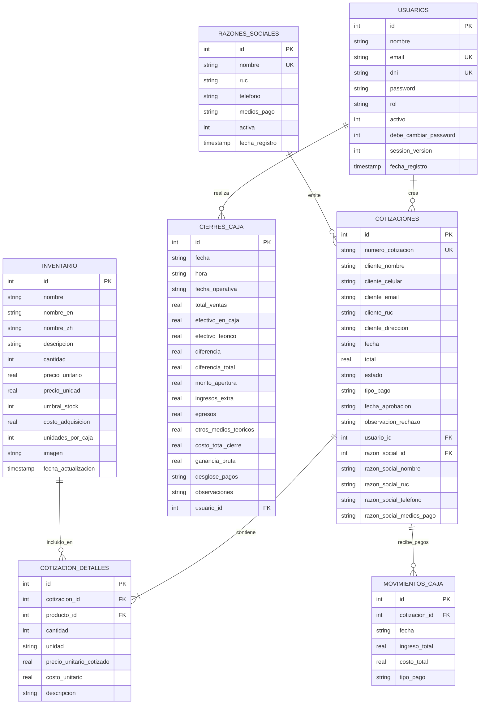

# Documentación Técnica y Funcional del Sistema Donglai ERP (GAT)

> **Versión del Sistema:** 2.0  
> **Fecha de Documentación:** Octubre 2026  
> **Entorno:** Aplicación Web Local / Intranet  
> **Tecnologías Principales:** Python 3.13, Flask 3.1, SQLite3, Jinja2, Bootstrap 5.3, ReportLab, pandas, openpyxl, Chart.js  

---

## 1. Resumen Ejecutivo y Propósito

**Donglai ERP (GAT)** es un sistema de gestión empresarial local diseñado para centralizar y optimizar las operaciones comerciales de la empresa. El sistema cubre el ciclo operativo completo:
1. **Control de Inventario:** Catálogo multilingüe de productos, gestión de existencias individuales vs. empaques por caja, y sincronización inteligente con archivos Excel (`PRODUCTOS.xlsx`).
2. **Emisión y Gestión de Cotizaciones:** Generación ágil con numeración correlativa mensual (ej. `202610-0001`), búsqueda y autocompletado histórico de clientes (por DNI/RUC o celular), soporte para múltiples razones sociales emisoras y generación de comprobantes en PDF de alta calidad.
3. **Cuentas por Cobrar y Pagos:** Registro de abonos parciales o totales vinculados a cada cotización y categorizados por medio de pago (Efectivo, Yape/Plin, Transferencia BCP, etc.).
4. **Cierre de Caja y Arqueo Diario:** Comparación automatizada entre el efectivo teórico y el efectivo real recontado en caja, control de ingresos y egresos extraordinarios y auditoría por usuario.
5. **Dashboard Analítico:** Visualización en tiempo real de métricas clave (ventas semanales, rendimiento por vendedor, productos más vendidos y medios de pago predominantes).

---

## 2. Arquitectura de Software

La aplicación sigue una arquitectura modular desacoplada basada en el microframework Flask, SQLite como motor de persistencia relacional con verificación de integridad referencial, y vistas generadas por Jinja2 en el servidor.

```
                    ┌────────────────────────────────────────┐
                    │          Navegador Web (Cliente)       │
                    │   HTML5 / CSS3 / Bootstrap 5 / JS      │
                    └───────────────────┬────────────────────┘
                                        │ HTTP (Puerto 5000)
                                        ▼
┌────────────────────────────────────────────────────────────────────────────────────┐
│                             Servidor de Aplicación Flask                           │
│                                                                                    │
│   ┌───────────────┐  ┌───────────────┐  ┌────────────────┐  ┌──────────────────┐   │
│   │  routes/auth  │  │ routes/quotes │  │ routes/inventory│  │routes/cash_close│   │
│   └───────────────┘  └───────────────┘  └────────────────┘  └──────────────────┘   │
│   ┌───────────────┐  ┌───────────────┐  ┌────────────────┐  ┌──────────────────┐   │
│   │ routes/admin  │  │routes/dashb'd │  │  excel_handler │  │   lenguajes.py   │   │
│   └───────────────┘  └───────────────┘  └────────────────┘  └──────────────────┘   │
└───────────────────────────────────────┬────────────────────────────────────────────┘
                                        │ SQL con Foreign Keys Activas
                                        ▼
                    ┌────────────────────────────────────────┐
                    │       Base de Datos Relacional         │
                    │         SQLite (donglai.db)            │
                    └────────────────────────────────────────┘
```

### 2.1 Estructura del Código Fuente
* [`app.py`](file:///C:/Users/HP/Desktop/GAT/GAT/app.py): Punto de entrada, configuración del servidor, inyección de variables globales en plantillas Jinja, middleware de idioma y carga dinámica de módulos.
* [`database.py`](file:///C:/Users/HP/Desktop/GAT/GAT/database.py): Abstracción de conexión a base de datos (`PRAGMA foreign_keys = ON`), esquemas de tablas, índices y funciones de auto-migración de columnas en caliente.
* [`excel_handler.py`](file:///C:/Users/HP/Desktop/GAT/GAT/excel_handler.py): Motor de ingesta y sincronización bidireccional con hojas de cálculo Excel (`PRODUCTOS.xlsx`).
* [`lenguajes.py`](file:///C:/Users/HP/Desktop/GAT/GAT/lenguajes.py): Diccionario centralizado de traducción trilingüe (Español `es`, Inglés `en`, Chino tradicional `zh`).
* [`crear_admin.py`](file:///C:/Users/HP/Desktop/GAT/GAT/crear_admin.py): Utilidad CLI segura para el alta o restablecimiento de la cuenta de Administrador Principal.
* `routes/`:
  * [`routes/auth.py`](file:///C:/Users/HP/Desktop/GAT/GAT/routes/auth.py): Manejo de sesiones, autenticación con Flask-Login, control de versiones de sesión y decoradores de roles (`@role_required`, `@admin_required`).
  * [`routes/admin.py`](file:///C:/Users/HP/Desktop/GAT/GAT/routes/admin.py): Gestión de usuarios, reseteo de credenciales y administración de empresas / razones sociales.
  * [`routes/dashboard.py`](file:///C:/Users/HP/Desktop/GAT/GAT/routes/dashboard.py): Endpoints del panel principal y API JSON con estadísticas en tiempo real.
  * [`routes/inventory.py`](file:///C:/Users/HP/Desktop/GAT/GAT/routes/inventory.py): Operaciones CRUD sobre productos, carga segura de imágenes raster y sincronización de Excel.
  * [`routes/quotes.py`](file:///C:/Users/HP/Desktop/GAT/GAT/routes/quotes.py): Creación, edición en línea con recuperación de borrador, generación de correlativo, búsqueda rápida de clientes y exportación a PDF vía ReportLab.
  * [`routes/cash_closing.py`](file:///C:/Users/HP/Desktop/GAT/GAT/routes/cash_closing.py): Flujo de apertura, arqueo, ingresos/egresos y consolidación del cierre de caja.
* `templates/`: Plantillas Jinja2 organizadas por dominio (`admin/`, `cierre_caja/`, `cotizaciones/`, `inventario/`, `pagos/`, `base.html`, `inicio.html`).
* `static/`: Recursos estáticos (estilos CSS, imágenes de productos en `uploads/products/` y logotipos).

---

## 3. Modelo de Datos (Base de Datos SQLite)

La base de datos activa reside en `donglai.db`. Todas las relaciones están protegidas mediante restricciones de clave externa.

### 3.1 Diagrama Entidad-Relación (ERD)



### 3.2 Detalle de Tablas y Atributos

| Tabla | Propósito | Columnas Clave |
|---|---|---|
| **`usuarios`** | Gestión de credenciales y permisos | `id`, `dni` (único de 8 dígitos), `email`, `password` (hash pbkdf2), `rol`, `activo` (1/0), `session_version` (para forzar cierre de sesión al revocar acceso). |
| **`razones_sociales`** | Empresas legales emisoras de cotizaciones | `id`, `nombre` (único), `ruc` (11 dígitos), `telefono`, `medios_pago` (cuentas bancarias), `activa`. |
| **`inventario`** | Catálogo general de productos | `id`, `nombre`, `cantidad` (stock real actual), `precio_unitario`, `costo_adquisicion`, `unidades_por_caja` (contenido del empaque), `imagen`. |
| **`cotizaciones`** | Cabecera de cotizaciones comerciales | `id`, `numero_cotizacion` (folio correlativo ej. `202610-0001`), `cliente_nombre`, `cliente_ruc`, `cliente_celular`, `estado` (`pendiente`, `Aprobada`, `Pagada`, `Parcial`, `Rechazada`), `total`, snapshots históricos de razón social. |
| **`cotizacion_detalles`** | Ítems individuales dentro de cada cotización | `id`, `cotizacion_id`, `producto_id`, `cantidad`, `unidad` (`und`, `caja`, `paquete`, `par`), `precio_unitario_cotizado`, `costo_unitario`. |
| **`movimientos_caja`** | Registro de ingresos monetarios por pagos de cotización | `id`, `cotizacion_id`, `fecha`, `ingreso_total`, `costo_total`, `tipo_pago` (Efectivo, Transferencia, Yape/Plin, etc.). |
| **`cierres_caja`** | Auditoría y liquidación diaria de caja | `id`, `fecha_operativa`, `monto_apertura`, `total_ventas`, `efectivo_en_caja` (físico), `efectivo_teorico`, `diferencia`, `ingresos_extra`, `egresos`, `ganancia_bruta`. |

---

## 4. Descripción de Módulos Funcionales

### 4.1 Autenticación y Control de Roles (RBAC)
El sistema implementa control de acceso basado en roles con el decorador `@role_required` y `@admin_required`:

* **Administrador (`admin`):** Acceso irrestricto a todo el sistema, gestión de usuarios, reseteo de claves, creación de razones sociales y eliminación lógica/física de registros sin historial vinculado.
* **Ventas (`ventas`):** Creación, edición, consulta y emisión en PDF de cotizaciones; búsqueda inteligente de clientes.
* **Inventario (`inventario`):** Visualización de existencias, ajuste de catálogo, carga de imágenes y sincronización con Excel.
* **Caja (`caja`):** Acceso al registro de pagos de cotizaciones, apertura y cierre diario de caja, arqueo e historial de liquidaciones.
* **Trabajador General (`usuario`):** Permiso para cotizar asignado a un vendedor con panel acotado.

> [!NOTE]
> Para garantizar la trazabilidad contable, las cuentas que posean cotizaciones o cierres de caja vinculados **no pueden eliminarse** de la base de datos; el sistema únicamente permite su **desactivación**.

---

### 4.2 Módulo de Inventario y Catálogo
* **Sincronización con Excel (`PRODUCTOS.xlsx`):** A través de [`excel_handler.py`](file:///C:/Users/HP/Desktop/GAT/GAT/excel_handler.py), el sistema lee las columnas `Producto`, `Cant/Caja`, `P. Venta Unit (S/)` y las columnas de existencias. 
  * La columna `Cant/Caja` se mapea a `unidades_por_caja` (factor de empaque).
  * La importación preserva el stock existente de los productos ya registrados sin sobrescribirlos, evitando pérdidas de conteo físico.
* **Validación de Archivos:** Las imágenes subidas por producto son analizadas a nivel de cabecera de bytes (*magic numbers*) para asegurar que sean archivos raster legítimos (PNG, JPEG, WEBP) antes de almacenarse en `static/uploads/products/`.

---

### 4.3 Módulo de Cotizaciones y Exportación PDF
* **Folios Correlativos Automáticos:** Cada cotización genera un número único formateado como `AAAAMM-XXXX` (ejemplo: `202610-0022`), reiniciando la secuencia cada mes automáticamente.
* **Autocompletado de Clientes:** Al ingresar el número de celular o RUC/DNI del cliente, una llamada asíncrona (`/cotizaciones/buscar_cliente`) autocompleta el nombre y la dirección, y despliega el historial de las últimas 10 cotizaciones del cliente con sus respectivos estados (incluyendo motivos de rechazo si los hubo).
* **Edición y Protección contra Pérdidas:**
  * Permite modificar productos, cantidades, precios y costos unitarios directamente desde la vista de detalle.
  * Cuenta con respaldo local en `sessionStorage` (`quote-edit-draft-{id}`). Si la conexión falla o el servidor reporta un error de validación, el navegador restaura automáticamente el borrador para no perder los datos digitados.
* **Generación de PDF con ReportLab:** Genera comprobantes profesionales con el logo corporativo, membrete legal con RUC, teléfono y medios de pago de la razón social seleccionada, tabla de productos con subtotales, y etiquetas informativas estructuradas en negrita (**Cliente**, **Vendedor**, **Fecha**, **Celular**, **Dirección**, **Pago**).

---

### 4.4 Módulo de Caja y Finanzas
* **Flujo de Pago:** Una cotización puede pasar de estado `pendiente` a `Parcial` o `Pagada` mediante la recepción de abonos individuales registrados en `movimientos_caja`.
* **Cierre Diario de Caja:**
  * **Efectivo Teórico:** Se calcula automáticamente sumando el fondo de apertura (`monto_apertura`), los ingresos por pagos en efectivo de cotizaciones y los ingresos extraordinarios, restando los egresos declarados.
  * **Arqueo Físico:** El cajero ingresa el monto real recontado físicamente (`efectivo_en_caja`).
  * **Cálculo de Diferencia:** El sistema registra de inmediato cualquier descuadre (`diferencia = efectivo_en_caja - efectivo_teorico`), alertando si hay sobrante o faltante.
  * **Rentabilidad Operativa:** Deduce el costo unitario de los productos cotizados respecto al precio de venta para determinar la `ganancia_bruta` acumulada en el día.

---

### 4.5 Dashboard y Analítica en Tiempo Real
El panel principal ([`templates/inicio.html`](file:///C:/Users/HP/Desktop/GAT/GAT/templates/inicio.html)) consulta periódicamente el endpoint `/api/dashboard-data` para presentar gráficos interactivos mediante Chart.js:
1. **Ventas de la Semana:** Gráfico de líneas que ilustra la tendencia diaria de cobros.
2. **Avance por Vendedor:** Gráfico de barras horizontales que mide el monto cobrado y el número de cotizaciones activas de cada trabajador en el mes en curso.
3. **Top 8 Productos Más Vendidos:** Ranking de artículos con mayor salida física y facturación.
4. **Distribución de Medios de Pago:** Gráfico tipo dona que desglosa el porcentaje de operaciones por efectivo, billeteras digitales y transferencias.
5. **Alertas de Stock Bajo:** Tabla dinámica que notifica cuando un producto cae por debajo de su umbral configurado.

---

## 5. Variables de Entorno y Configuración

El archivo [`app.py`](file:///C:/Users/HP/Desktop/GAT/GAT/app.py) soporta parametrización mediante variables de entorno para adaptarse a diferentes entornos locales:

| Variable | Descripción | Valor Predeterminado |
|---|---|---|
| `GAT_SECRET_KEY` | Llave secreta para el firmado criptográfico de cookies de sesión | Generada aleatoriamente al iniciar |
| `GAT_DATABASE_PATH` | Ruta absoluta o relativa al archivo SQLite | `donglai.db` junto al código |
| `GAT_EXCEL_PATH` | Ruta al archivo Excel del inventario maestro | `PRODUCTOS.xlsx` |
| `GAT_HOST` | Interfaz de red de enlace (`0.0.0.0` para acceso en red local) | `0.0.0.0` |
| `GAT_PORT` | Puerto TCP del servicio HTTP | `5000` |
| `GAT_DEBUG` | Activa recarga en caliente y depurador interactivo | Desactivado (`0` o `false`) |
| `GAT_ADMIN_USER_ID`| Identificador del usuario que actúa como Administrador Principal | `1` |

---

## 6. Procedimientos de Operación y Mantenimiento

### 6.1 Inicio del Servidor
Para iniciar la aplicación en el equipo anfitrión:
```powershell
cd C:\Users\HP\Desktop\GAT\GAT
python app.py
```
La aplicación queda disponible en `http://localhost:5000` y en la dirección IP local de la máquina (por ejemplo `http://192.168.100.11:5000`).

### 6.2 Recuperación o Creación del Administrador Principal
Si se pierde el acceso administrativo o se instala en una nueva máquina:
```powershell
python crear_admin.py
```
Este script interactivo solicita el número de DNI y la nueva contraseña, promueve dicha cuenta a Administrador Principal y degrada accesos huérfanos para garantizar que no existan accesos no autorizados.

### 6.3 Políticas de Respaldo (Backup)
Para respaldar completamente el estado del sistema, solo se requiere copiar dos archivos:
1. **`donglai.db`:** Contiene toda la información transaccional, usuarios, clientes, cotizaciones, pagos y cierres de caja.
2. **`PRODUCTOS.xlsx`:** Catálogo de productos.
3. **Carpeta `static/uploads/products/`:** Fotografías asociadas a los productos.
